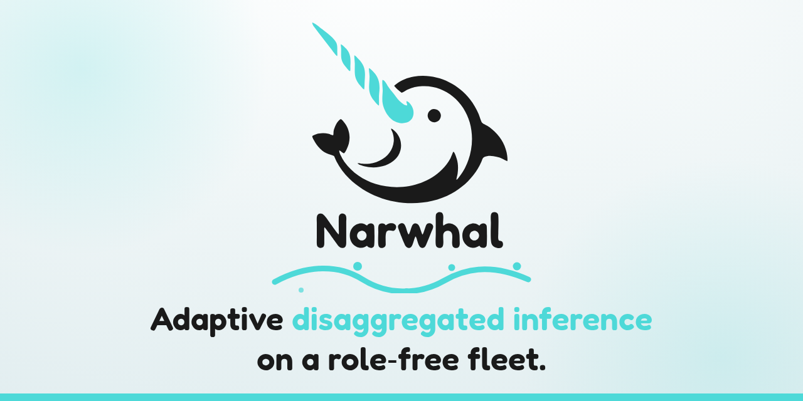

<p align="center">
  
</p>

<p align="center">
  
  
  
  
  <a href="https://pypi.org/project/narwhal-inference/"></a>
</p>

<p align="center">
  <a href="https://athrael-soju.github.io/Narwhal/"></a>
  <a href="https://athrael-soju.github.io/Narwhal/Deploy/"></a>
  <a href="https://athrael-soju.github.io/Narwhal/HTTP-API/"></a>
  <a href="https://github.com/athrael-soju/Narwhal/issues"></a>
  <a href="https://github.com/athrael-soju/Narwhal/blob/main/CONTRIBUTING.md"></a>
</p>

## What is Narwhal?

Narwhal is a disaggregated inference framework that automatically hot-swaps prefill and decode roles as demand changes, without reloading model weights. It runs on a [single GPU](https://athrael-soju.github.io/Narwhal/Dev-Runtime/) or across [multi-node deployments](https://athrael-soju.github.io/Narwhal/Deploy/).

<p align="center">
  
</p>

Eight llama.cpp engines on a machine with no GPU: start the fleet, ask one question, then run the demo load. Under long replies the router moves prefill engines to decode. When long prompts arrive, it moves them back to prefill. None of the demo's 757 requests failed or was turned away.

## Try it out

<p align="center">
  <a href="https://codespaces.new/athrael-soju/Narwhal?quickstart=1"></a>
</p>

The button opens a codespace with Narwhal installed from this repository. Run the commands below in its terminal; the fleet runs on the CPU. On your own machine, [install Narwhal](#installing) first.

Narwhal dev runs four llama.cpp engines and a router on one Linux or WSL2 machine, on an NVIDIA GPU or on the CPU alone. Setup downloads the engine and a model under one billion parameters, 0.3 GB with the CPU build of the engine and 1.0 GB with the CUDA 12 build.

```bash
narwhal dev up
narwhal dev ask "What is the capital of France?"
narwhal dev demo
narwhal dev down --remove
```

`up` downloads the engine and the model on its first run, then starts the fleet with four engines; the recording above adds `--engine-count 8`. `ask` prints a reply and the engines that served its prefill and decode. `demo` sends long replies and then long prompts for 30 seconds each while the live view shows the engines change roles. `down --remove` stops the fleet and deletes the downloads. To drive the fleet yourself, run `narwhal dev watch` in one terminal and `narwhal dev ask --repeat 200 --concurrency 8` in another.

To run vLLM, SGLang or TensorRT-LLM engines on one NVIDIA GPU instead, use `narwhal dev init`. That fleet goes through the same attestation, profiling and KV transfer checks as a deployed fleet.

<p align="center">
  <a href="https://athrael-soju.github.io/Narwhal/dev/Quick-Start/"></a>
  <a href="https://athrael-soju.github.io/Narwhal/cli/Dev/"></a>
  <a href="https://athrael-soju.github.io/Narwhal/Dev-Runtime/"></a>
  <a href="https://athrael-soju.github.io/Narwhal/dev/RTX-5090-Reference/"></a>
</p>

## What it does

<table width="100%" align="center">
  <thead>
    <tr>
      <th align="left" width="18%">Capability</th>
      <th align="left" width="52%">Behavior</th>
      <th align="left" width="30%">Guide</th>
    </tr>
  </thead>
  <tbody>
    <tr>
      <td>Role hot-swap</td>
      <td>Reassigns prefill and decode roles across a GPU fleet, with NIXL key-value (KV) transfer between them</td>
      <td><a href="https://athrael-soju.github.io/Narwhal/Core-Concepts/"></a></td>
    </tr>
    <tr>
      <td>Serving</td>
      <td>Serves completion and chat requests, streamed or buffered, with latency-aware admission</td>
      <td><a href="https://athrael-soju.github.io/Narwhal/HTTP-API/"></a></td>
    </tr>
    <tr>
      <td>Fault tolerance</td>
      <td>Fails over to a warm-standby router, readmits engines against their live process generation, and joins or removes engines without a restart</td>
      <td><a href="https://athrael-soju.github.io/Narwhal/Operate/"></a></td>
    </tr>
    <tr>
      <td>Measurement</td>
      <td>Profiles engines, runs ordered benchmark points, and keeps the evidence from each point</td>
      <td><a href="https://athrael-soju.github.io/Narwhal/Measure/"></a></td>
    </tr>
    <tr>
      <td>Observability</td>
      <td>Exports router and engine metrics to Prometheus and a provisioned Grafana dashboard</td>
      <td><a href="https://athrael-soju.github.io/Narwhal/Observability/"></a></td>
    </tr>
    <tr>
      <td>Operator tooling</td>
      <td>Validates fleet files offline and collects private diagnostic bundles</td>
      <td><a href="https://athrael-soju.github.io/Narwhal/CLI-Reference/"></a></td>
    </tr>
    <tr>
      <td>Development mode</td>
      <td>Runs two to eight engines on one workstation under Ubuntu or WSL2, on a GPU or the CPU</td>
      <td><a href="https://athrael-soju.github.io/Narwhal/dev/Quick-Start/"></a></td>
    </tr>
  </tbody>
</table>

## How engines change roles

The role controller scores the current role split and each adjacent split, one engine move away. It uses measured engine profiles, offered demand, and resident work, and moves one engine only when the worst projected SLO ratio improves and every role, lifecycle, and resident-work guard passes. New requests follow the revised split, and resident requests finish on their assigned engines.

<p align="center">
  <a href="https://athrael-soju.github.io/Narwhal/concepts/02-Role-Control/"></a>
</p>



## Evaluation

The [evaluation](https://athrael.net/posts/evaluating-narwhal/) ran Narwhal v0.1.0, Dynamo Planner and Ray Serve LLM on identical six-engine hardware, under two request schedules whose mix changes quickly. With prefix caching on, these are the shares of offered requests that met the SLO: a first token within 2.1 s, at most 45 ms per output token, and a natural finish.

| Workload | Narwhal | Dynamo Planner | Ray Serve LLM |
| --- | --- | --- | --- |
| Chat and documents | **76.2%** | 56.8% | 51.7% |
| Mixed | **45.6%** | 21.7% | 37.1% |

Each configuration ran once. On mixed traffic, Narwhal's 95th-percentile time to first token was 11.3 s against 1.2 s for Ray Serve LLM. The post covers the setup, every metric and the limits of the comparison.

## Installing

Install on Linux with Python 3.11 or newer:

```bash
python3 -m venv .venv
source .venv/bin/activate
python -m pip install narwhal-inference
narwhal-serve --version
narwhal --help
```

The wheel installs `narwhal`, `narwhal-engine`, `narwhal-serve`, `narwhal-attest`, `narwhal-profile`, and `narwhal-check`. To verify the installation, follow [Installing from PyPI](https://athrael-soju.github.io/Narwhal/Install-from-PyPI/). For each command's options, use the [CLI reference](https://athrael-soju.github.io/Narwhal/CLI-Reference/).

## Bringing up a fleet

Run the deployment gates in [Deploying a fleet](https://athrael-soju.github.io/Narwhal/Deploy/) from a management workstation. The [documentation site](https://athrael-soju.github.io/Narwhal/) has the rest.

## Contributing

<p align="center">
  <a href="https://github.com/athrael-soju/Narwhal/blob/main/CONTRIBUTING.md"></a>
  <a href="https://github.com/athrael-soju/Narwhal/blob/main/CODE_OF_CONDUCT.md"></a>
  <a href="https://github.com/athrael-soju/Narwhal/blob/main/SECURITY.md"></a>
</p>

## Built on Arrow

Narwhal's scheduling algorithms are based on Arrow: Adaptive Scheduling Mechanisms for Disaggregated LLM Inference Architecture by Wu et al. (2025).

<p align="center">
  <a href="https://arxiv.org/abs/2505.11916"></a>
  <a href="https://github.com/athrael-soju/Narwhal/blob/main/CITATION.cff"></a>
  <a href="https://github.com/athrael-soju/Narwhal/blob/main/LICENSE"></a>
</p>
