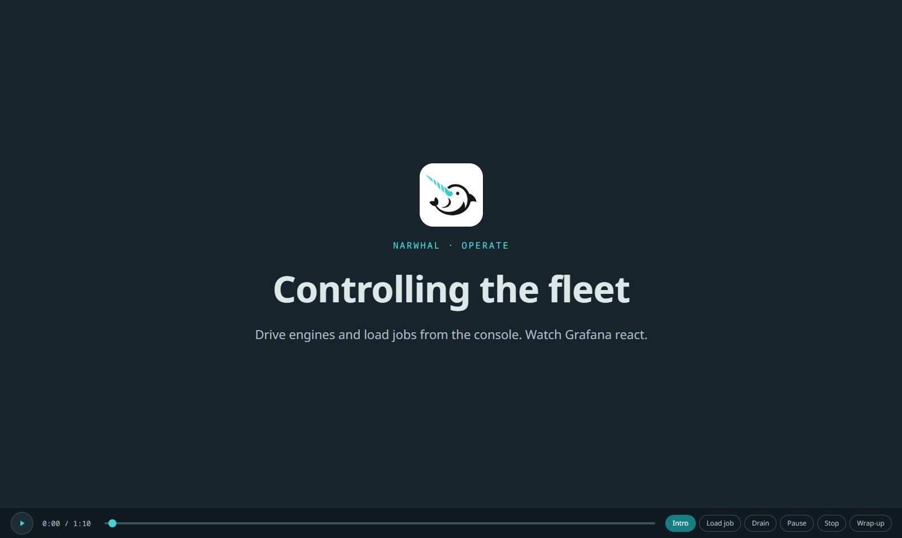

# Controlling the fleet

The fleet control service runs operator test actions against a running Narwhal fleet from a browser console:

- engine pause, resume, stop, start, drain and readmit
- configuration overlays
- cold restarts and baseline restores
- AIPerf load jobs

The service runs on the router host, listens on loopback and authenticates API requests with a bearer token. From a workstation, open its console at `/console` through the operator tunnel. The **Narwhal Orchestrator** dashboard links to the console and marks each action and load job on its charts.

All work happens in a session. Starting a session validates the baseline fleet configuration and copies it. Ending a session stops a running load job and closes the session's record, and the fleet keeps the session's changes. Select **Restore baseline** before you end the session to undo them. The service writes each action, with its time and effect, to the session's private run record.

Engine pause, resume, stop and start, overlays and cold restarts run hooks: commands you define in the private configuration, such as one that stops an engine or restarts the router. Drains and readmits call the router's lifecycle API.

## Walkthrough

{ .narwhal-walkthrough-trigger }

<dialog id="fleet-control-walkthrough" class="narwhal-walkthrough-dialog" aria-label="Fleet control walkthrough"><button type="button" class="narwhal-walkthrough-close" aria-label="Close walkthrough">×</button><iframe title="Fleet control walkthrough"></iframe></dialog>

## Pages

-   [Setting up the control service](fleet-control/01-Set-Up-the-Service.md)

    ---

    Write the private configuration, set the token, and start the service.

-   [Opening the console](fleet-control/02-Open-the-Console.md)

    ---

    Reach the console through the tunnel and choose how it authenticates.

-   [Using the console from Grafana](fleet-control/03-Grafana-Dashboard.md)

    ---

    Open the console from the Narwhal Orchestrator dashboard and mark actions on its charts.

-   [Running a test session](fleet-control/04-Sessions.md)

    ---

    Start and end sessions, read the session strip, and follow the activity log.

-   [Engine actions](fleet-control/05-Engine-Actions.md)

    ---

    Pause, stop, drain and readmit engines.

-   [Load jobs](fleet-control/06-Load-Jobs.md)

    ---

    Run AIPerf workloads against the router and read the results.

-   [Overlays, cold restarts and restores](fleet-control/07-Configuration-Changes.md)

    ---

    Change serving settings mid-session, restart the fleet, or return to the baseline.

-   [Troubleshooting the console](fleet-control/08-Troubleshooting.md)

    ---

    Empty panels, missing chart markers, and engines stuck after a drain or stop.

-   [Configuration reference](fleet-control/09-Configuration-Reference.md)

    ---

    Configuration keys, the hook contract and hook environment.

-   [API reference](fleet-control/10-API-Reference.md)

    ---

    Routes, request fields, status codes and metrics.

-   [Run record](fleet-control/11-Run-Record.md)

    ---

    Session files, the `run.json` schema and journal extracts.

